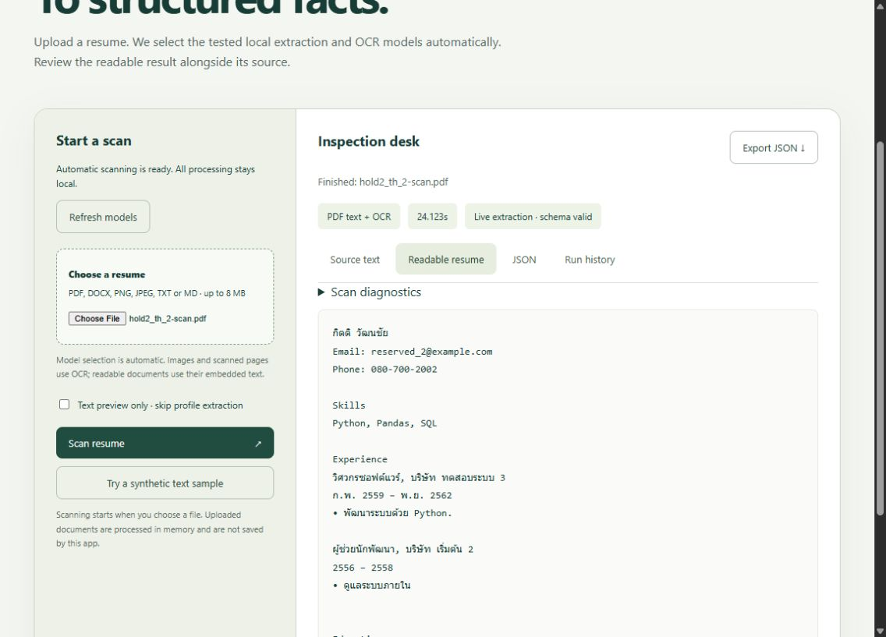

# Resume AI

A local tool for turning English and Thai resumes into readable, structured information.

Upload a resume and the app picks the tested extraction and OCR models for you. You can review the result alongside the source and export it as JSON. Resume processing uses local Ollama models.

## Try it

You need Python 3.10+, Ollama, and the model versions listed in [the setup notes](resume-lab/TECHNICAL-NOTES.md). The included policy is tied to the tested model versions; it will tell you when a required model is missing or has changed.

With Ollama running, open a terminal in this repository:

```sh
cd resume-lab
python -m pip install -r requirements.txt
python server.py
```

Open **http://127.0.0.1:8765**, then upload a PDF, DOCX, image or text file. You can also click **Try a synthetic text sample** to see how it works.

## What to expect

The app uses Qwen for extraction and Typhoon for OCR when a document needs it. There are no model dropdowns to configure.

This is a testing tool, so check the result before using it. Scanned names and dates can still be wrong. It does not rank candidates or make hiring decisions.

## Results at a glance

Latest test: **6 October 2026 · 40/40 regression tests passed · 36/36 uploads completed.**

We tested 9 synthetic resumes (English, Thai and bilingual), each in 4 formats, using local models on an RTX 4080. These are repeat checks on the same test set, not new unseen resumes.

| Resume format | Identity accuracy | Work & education score | Date accuracy | Skill F1 | Average scan time |
|---|---:|---:|---:|---:|---:|
| Text | 100.0% | 96.8% | 90.7% | 100.0% | 2.94 s |
| Digital PDF | 100.0% | 96.3% | 97.2% | 100.0% | 2.91 s |
| PNG image | 92.6% | 87.5% | 84.1% | 100.0% | 12.89 s |
| Scanned PDF | 92.6% | 94.0% | 90.7% | 100.0% | 9.97 s |

Scores compare extracted fields with the expected answers. Skill F1 balances missing and extra skills. Time covers the complete upload request, including OCR when needed, and varies with hardware and model loading.

**What this means:** text and digital PDFs worked best in this small test. Scanned names and dates still need checking. Completing all uploads does not mean every detail was correct; these scores are not a guarantee for real-world resumes.

<details>
<summary>See an example Thai resume result</summary>



This example shows a separate browser scan; its displayed time is not the benchmark average above.

</details>

## More details

- [Latest test report](resume-lab/evaluation/test-run-2026-10-06/REPORT.md)
- [Model comparison and accuracy](resume-lab/evaluation/SCORECARD.md)
- [Setup, troubleshooting and test commands](resume-lab/TECHNICAL-NOTES.md)

The browser app lives in `resume-lab/`. Earlier pipeline and training experiments remain in the other folders; their [original notes](docs/LEGACY-README.md) are kept for reference and may contain outdated claims.
